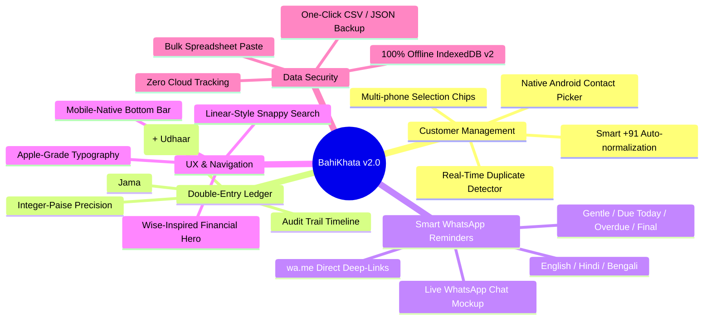
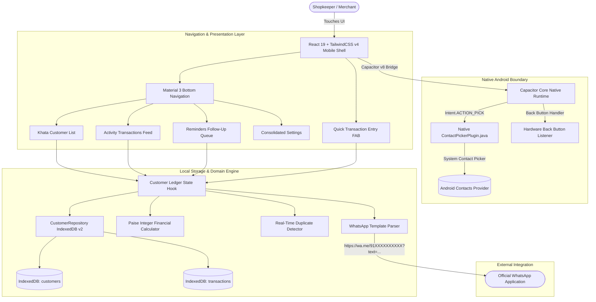
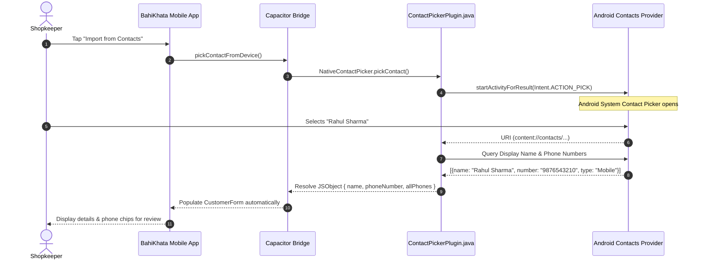
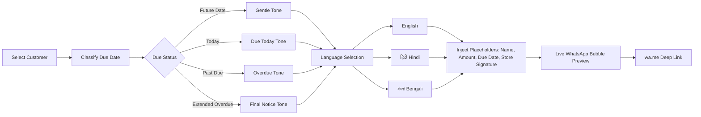

<p align="center">
  
</p>

<h1 align="center">बहीखाता — BahiKhata v2.0</h1>

<p align="center">
  <strong>The Modern, Private, Offline-First Digital Ledger & Smart Payment Reminder System for Android & Web.</strong>
</p>

<p align="center">
  <a href="releases/v2.0.0/BahiKhata-v2.0.0.apk"></a>
  <a href="#-architecture--data-flow"></a>
  <a href="#-automated-testing--quality-assurance"></a>
  <a href="LICENSE"></a>
</p>

<p align="center">
  
  
  
  
  
  
</p>

---

## 📖 Table of Contents

- [🌟 Product Overview](#-product-overview)
- [📥 Quick Download & Installation](#-quick-download--installation)
- [✨ Key Features & Capabilities](#-key-features--capabilities)
- [🏗️ System Architecture & Data Flow](#️-system-architecture--data-flow)
- [📱 Native Android Contact Integration](#-native-android-contact-integration)
- [🔢 Mathematical Financial Precision (Zero Floating-Point)](#-mathematical-financial-precision-zero-floating-point)
- [💬 Multilingual WhatsApp Reminder Engine](#-multilingual-whatsapp-reminder-engine)
- [🎨 Design System & Reference Standards](#-design-system--reference-standards)
- [🛠️ Technology Stack](#️-technology-stack)
- [💻 Local Development & Android Build Guide](#-local-development--android-build-guide)
- [🧪 Automated Testing & Quality Assurance](#-automated-testing--quality-assurance)
- [🔒 Data Privacy & Security Commitments](#-data-privacy--security-commitments)
- [📄 License](#-license)

---

## 🌟 Product Overview

**BahiKhata (बहीखाता)** transforms informal, paper-based merchant accounting into a fast, elegant, and secure digital ledger. Built specifically for Indian shopkeepers, kirana stores, tuition teachers, tailors, freelancers, and small wholesalers, BahiKhata eliminates tedious manual reminder composition and ledger math.

> **Core Product Guarantee:**  
> *"Who owes me money, how much do they owe, and how do I remind them instantly?"*  
> **Add customer $\rightarrow$ Record transactions $\rightarrow$ View balances $\rightarrow$ Send WhatsApp reminder in 2 taps.**

- **🚫 Zero Mandatory Accounts:** No signup, no phone OTP, no passwords.
- **🔒 100% Device-Local Autonomy:** Operates entirely inside device IndexedDB (`BahiKhataDB`). Zero remote databases, zero analytics, zero surveillance.
- **📱 Android-Native Performance:** Optimized for one-handed smartphone thumb navigation, full Android back-button stacks, and native contact picking.
- **💬 Direct WhatsApp Deep-Linking:** Generates localized reminder messages sent via user-controlled WhatsApp links without costly enterprise APIs.

---

## 📥 Quick Download & Installation

| Build Asset | Target Platform | Checksum (SHA-256) | Download Link |
| :--- | :--- | :--- | :--- |
| **BahiKhata v2.0.0 APK** | Android 7.0+ (ARM64/x86_64) | `8210090b6bca557701360248cb0d6b16213595a8d31764ad2b6e940d307cb645` | [📦 Download BahiKhata-v2.0.0.apk](releases/v2.0.0/BahiKhata-v2.0.0.apk) |
| **BahiKhata v1.0.0 APK** | Android 7.0+ (Legacy) | `57fdccd4e391300977da9067b575fae8fae852462e08ba5bba626b46c692ff5c` | [📦 Download BahiKhata-v1.0.0.apk](releases/v1.0.0/BahiKhata-v1.0.0.apk) |

### Installing via Android Device
1. Download **[BahiKhata-v2.0.0.apk](releases/v2.0.0/BahiKhata-v2.0.0.apk)** directly onto your phone.
2. Tap the downloaded file and select **Install** (*Allow installation from unknown sources* if prompted).
3. Open **BahiKhata** and manage your khata immediately!

### Installing via ADB (Command-Line)
```bash
adb install -r releases/v2.0.0/BahiKhata-v2.0.0.apk
adb shell am start -n com.bahikhata.app/.MainActivity
```

---

## ✨ Key Features & Capabilities



### 1. Native Android Contact Picker
- Pick existing customer contacts directly from your Android address book.
- Automatically retrieves display names and phone numbers.
- Handles contacts with multiple phone numbers (Mobile, Home, Work) with simple tap-chips.
- Respects device privacy by requesting access strictly to the picked contact.

### 2. Full Transaction Ledger & Audit Timeline
- Record **Gave Credit (+ Udhaar)** and **Got Payment (- Jama)** in 2 taps.
- Customer detail view features full transaction history with timestamps, custom item notes, and running balance calculations.
- Delete or correct mistaken entries with automatic balance recalculation.

### 3. Real-Time Customer Duplicate Detection
- Prevent duplicate accounts: when typing a mobile number or importing a contact, the app alerts if a customer already exists and links directly to their existing ledger.

### 4. Smart WhatsApp Payment Reminders
- Choose from 3 regional languages (**English**, **हिंदी**, **বাংলা**).
- 4 contextual reminder tones (**Gentle Pre-due**, **Due Today**, **Overdue**, **Final Notice**).
- Automatic placeholder substitution: `{{name}}`, `{{amount}}`, `{{due_date}}`, `{{reason}}`, and custom business signature.
- Live chat bubble mockup and 1-tap deep link generation to WhatsApp.

### 5. Follow-Up Reminders Queue
- Dedicated **Reminders** view ranking customers by payment urgency (Overdue first $\rightarrow$ Due Today $\rightarrow$ Due Soon) with instant 1-tap WhatsApp reminder buttons.

### 6. Activity Feed & Daily Cashflow
- Chronological transaction feed tracking all credits and payments across all customers with daily financial totals.

### 7. Spreadsheet Bulk Paste & Data Portability
- Paste rows from Excel, Google Sheets, or TSV directly into the app for multi-customer creation.
- 1-click **Export to CSV** and **Full JSON Backup**.
- 2-step protected local data erase mechanism.

---

## 🏗️ System Architecture & Data Flow



---

## 📱 Native Android Contact Integration



---

## 🔢 Mathematical Financial Precision (Zero Floating-Point)

In standard JavaScript, floating-point arithmetic introduces rounding anomalies:
```javascript
// Standard JavaScript floating-point bug:
0.1 + 0.2 = 0.30000000000000004
```

In BahiKhata, every monetary value is converted to integer **Paise** at entry:

$$\text{Paise} = \text{round}(\text{Rupees} \times 100)$$

$$\text{Net Balance} = \sum_{i=1}^{n} \text{Credit}_i - \sum_{j=1}^{m} \text{Payment}_j$$

| State | Condition | UI Indication | Financial Meaning |
| :--- | :--- | :--- | :--- |
| **Pending Due** | $\text{Balance} > 0$ | 🔴 Crimson (`text-bk-status-overdue`) | Customer owes money to shopkeeper |
| **Settled** | $\text{Balance} = 0$ | 🟢 Forest Green (`text-bk-status-paid`) | Account fully settled |
| **Advance** | $\text{Balance} < 0$ | 🔵 Blue (`text-blue-600`) | Customer paid advance / shopkeeper owes customer |

---

## 💬 Multilingual WhatsApp Reminder Engine

BahiKhata comes pre-configured with culturally appropriate reminder templates tailored to Indian small-business communication:



### Supported Languages
1. **English:**  
   *"Hello {{name}}, this is a gentle reminder that your pending balance of {{amount}} is due on {{due_date}}. Thank you! — {{shop_name}}"*
2. **हिंदी (Hindi):**  
   *"नमस्ते {{name}}, यह एक विनम्र अनुस्मारक है कि आपकी {{amount}} की लंबित राशि {{due_date}} को देय है। धन्यवाद! — {{shop_name}}"*
3. **বাংলা (Bengali):**  
   *"নমস্কার {{name}}, এটি একটি মৃদু অনুস্মারক যে আপনার {{amount}} টাকার বকেয়া বিলটি {{due_date}} তারিখে পরিশোধ করার কথা। ধন্যবাদ! — {{shop_name}}"*

---

## 🎨 Design System & Reference Standards

BahiKhata synthesizes principles from premier digital products:

- **Apple Human Interface:** Negative letter-spacing, generous whitespace, subtle hairline dividers (`#e8e6e1`), restrained color palettes, and focused typography.
- **Wise (TransferWise):** Crystal-clear financial status hierarchy, bold tabular monetary digits (`font-mono`), high-contrast due indicators, and Scandinavian-clean card geometry.
- **Linear:** High-efficiency information density, instant search with keyboard shortcuts, refined sort dropdowns, and responsive filter chips.
- **Material Design 3:** Fixed bottom navigation (thumb zone), mobile drawer sheets with drag indicators, and minimum 44px touch targets.
- **Intercom:** Authentic chat bubble previews and communication-first workflow design.

---

## 🛠️ Technology Stack

| Layer | Technologies | Purpose |
| :--- | :--- | :--- |
| **Frontend Framework** | React 19.2, TypeScript 6 | Component composition and compile-time type safety |
| **Styling & Tokens** | TailwindCSS v4, Inter Variable Typography | Modern CSS-first utility styling and design tokens |
| **Local Persistence** | IndexedDB (Database: `BahiKhataDB` v2) | Structured offline-first client storage |
| **Native Runtime** | Capacitor v8 Android, Native Java Plugin | Android WebView runtime and native Intent bridges |
| **Testing Engine** | Vitest 4.1 | High-speed unit and regression test suite |
| **Linting & Code Quality** | Oxlint 1.79 | Fast AST-based static analysis |
| **Build & Tooling** | Vite 8, Gradle 8, Android SDK 36, Java 17 | Web bundling, asset compression, and APK compilation |

---

## 💻 Local Development & Android Build Guide

### Prerequisites
- Node.js (v20+) & npm
- Java JDK 17 (Temurin / OpenJDK)
- Android SDK Platform 36 & build-tools (35.0.0+)
- Android device or emulator with ADB debugging enabled

### 1. Clone & Install Dependencies
```bash
git clone https://github.com/joydeepdas-01/BahiKhata.git
cd BahiKhata
npm install
```

### 2. Start Vite Development Server
```bash
npm run dev
```

### 3. Run Quality Verification Suite
```bash
npm run lint
npm test
```

### 4. Build Production Web Assets & Sync to Android
```bash
npm run build
npx cap sync android
```

### 5. Compile Android Debug APK
```bash
cd android
./gradlew.bat assembleDebug
```
The compiled APK will be output at:  
`android/app/build/outputs/apk/debug/app-debug.apk`

### 6. Deploy & Install Directly to Phone via ADB
```bash
adb install -r android/app/build/outputs/apk/debug/app-debug.apk
adb shell am start -n com.bahikhata.app/.MainActivity
```

---

## 🧪 Automated Testing & Quality Assurance

BahiKhata features 100% test pass rates across all core domain modules:

```text
 ✓ src/domain/__tests__/customer.test.ts (4 tests)
 ✓ src/domain/__tests__/amountFormatter.test.ts (7 tests)
 ✓ src/domain/__tests__/phoneNormalizer.test.ts (8 tests)
 ✓ src/domain/__tests__/dateClassifier.test.ts (9 tests)
 ✓ src/domain/__tests__/templates.test.ts (3 tests)
 ✓ src/domain/__tests__/csvHelper.test.ts (3 tests)
 ✓ src/domain/__tests__/tsvHelper.test.ts (3 tests)

 Test Files  7 passed (7)
      Tests  37 passed (37)
```

Run test suite anytime with:
```bash
npm test
```

---

## 🔒 Data Privacy & Security Commitments

1. **Zero Cloud Dependencies:** Your customer data, phone numbers, and transaction ledgers never leave your physical device.
2. **No Tracking or Telemetry:** BahiKhata contains zero analytics SDKs, advertising trackers, or tracking pixels.
3. **Contact Sandboxing:** Contact information retrieved via Android's native contact picker remains exclusively within local device storage.
4. **Transparent User Control:** Reminders only generate standard deep links; you always review and perform the final Send action inside WhatsApp.

---

## 📄 License

Distributed under the **MIT License**. See [LICENSE](LICENSE) for full details.

---

<p align="center">
  Crafted with ❤️ for India's hardworking merchants and small businesses.
</p>
