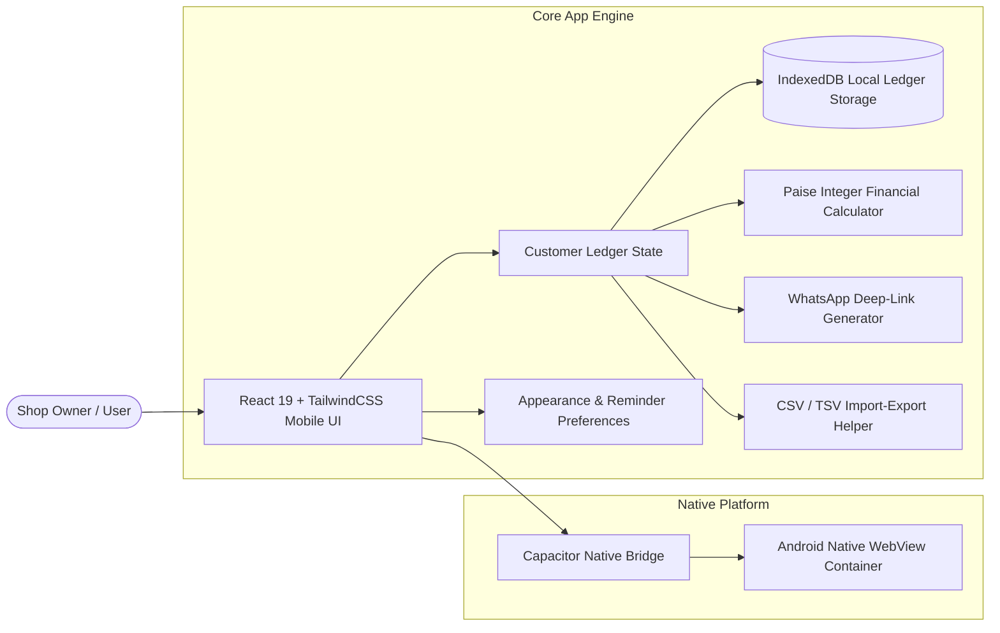

# BahiKhata (बहीखाता)

> A modern, offline-first digital Bahi-Khata for managing customer credit ledgers, payment tracking, and WhatsApp reminders with zero cloud tracking.

[](releases/v1.0.0/BahiKhata-v1.0.0.apk)
[](LICENSE)
[](#-android-installation)
[](docs/PRIVACY.md)
[](docs/DEVELOPMENT.md)

---

## 📥 Quick Download

| Asset | Link | Checksum |
| :--- | :--- | :--- |
| **Android APK (v1.0.0)** | [📦 Download BahiKhata-v1.0.0.apk](releases/v1.0.0/BahiKhata-v1.0.0.apk) | `57fdccd4...26b46c692ff5c` ([SHA256SUMS.txt](releases/v1.0.0/SHA256SUMS.txt)) |

---

## 🌟 Key Features

<details open>
<summary><b>Click to expand Feature Overview</b></summary>

- **🔒 100% Offline Autonomy**: All data is stored locally in device IndexedDB (`bahikhata_db`). Zero cloud dependencies, zero latency, 100% private.
- **🔢 0 Rounding Floating-Point Precision**: Financial dues are calculated and persisted strictly as integer **Paise** (`₹100.50` $\rightarrow$ `10050` Paise), eliminating floating-point rounding errors.
- **💬 Multilingual WhatsApp Reminders**: Generate custom WhatsApp payment reminders in **English**, **Hindi (हिंदी)**, and **Bengali (বাংলা)** with live text preview.
- **📱 Independent Responsive Typography Scaling**: Changing Text Size (**Small**, **Standard**, **Large**, **Extra Large**) alters typography scale ONLY. Layout width and container geometry remain 100% stable.
- **📐 Reusable Outer Content Margin**: Built-in 10px safe margin container (`AppContentContainer`) preventing components from touching extreme mobile screen edges.
- **⚙️ Complete App Settings Architecture**: Comprehensive control panel featuring **Appearance**, **Reminder Settings**, **Preferences**, **Data Backup (CSV/TSV)**, and **Safe Reset**.
- **📊 Quick Bulk Add Sheet**: Spreadsheet modal for fast multi-customer creation.

</details>

---

## 🏗️ System Architecture & Data Flow



---

## 🛠️ Technology Stack

| Layer | Technology |
| :--- | :--- |
| **User Interface** | React 19, TailwindCSS v4, Inter Typography |
| **Application State** | React Context + Custom Hooks |
| **Local Database** | IndexedDB (`bahikhata_db`) |
| **Native Runtime** | Capacitor v8 Android Wrapper |
| **Testing** | Vitest (33 Unit Tests), Oxlint |
| **Build Tools** | Vite 8, TypeScript 6, Gradle 8 |

---

## 📲 Android Installation

1. Download [BahiKhata-v1.0.0.apk](releases/v1.0.0/BahiKhata-v1.0.0.apk) onto your Android device.
2. Tap the downloaded file to install (Enable *Install from unknown sources* if prompted).
3. Open **BahiKhata** and start managing customer ledgers!

---

## 💻 Local Development Setup

```bash
# Clone the repository
git clone https://github.com/dhrubesh/BahiKhata.git
cd BahiKhata

# Install dependencies
npm install

# Start Vite dev server
npm run dev

# Run Vitest test suite
npx vitest run

# Build web assets and sync to Android
npm run build
npx cap sync android

# Build Android APK
cd android
./gradlew assembleDebug
```

---

## 📚 Project Documentation

- 📄 [ARCHITECTURE.md](docs/ARCHITECTURE.md) — Detailed software architecture & data flow.
- 🛠️ [DEVELOPMENT.md](docs/DEVELOPMENT.md) — Environment setup & Android deployment guide.
- 📦 [RELEASE.md](docs/RELEASE.md) — Release procedure, checksums & signature policy.
- 🔒 [PRIVACY.md](docs/PRIVACY.md) — 100% Local data privacy policy.
- 🗃️ [DATA_MODEL.md](docs/DATA_MODEL.md) — Integer currency formulas & domain entities.
- 🗺️ [ROADMAP.md](docs/ROADMAP.md) — Feature milestones & future goals.

---

## 📄 License & Security

Distributed under the **MIT License**. See [LICENSE](LICENSE) for details.  
Report security vulnerabilities according to our [Security Policy](SECURITY.md).
