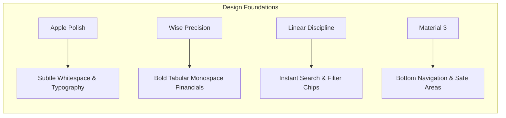
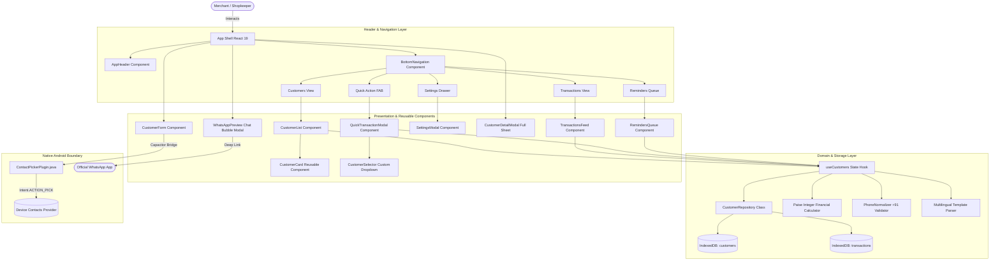
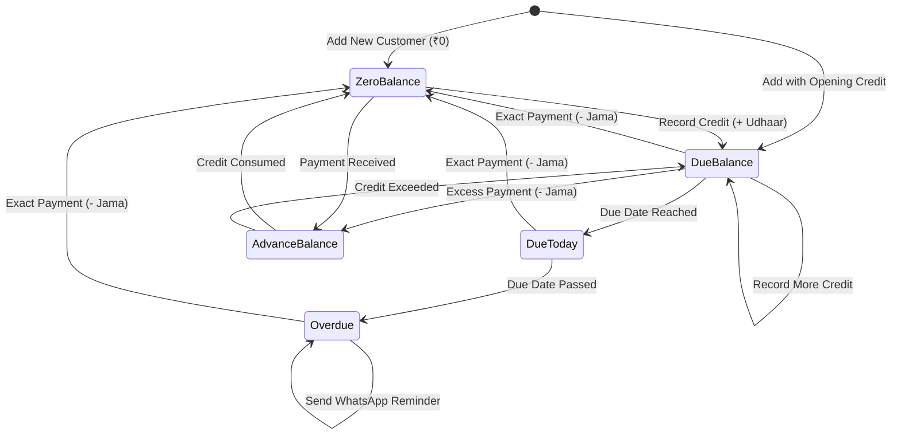
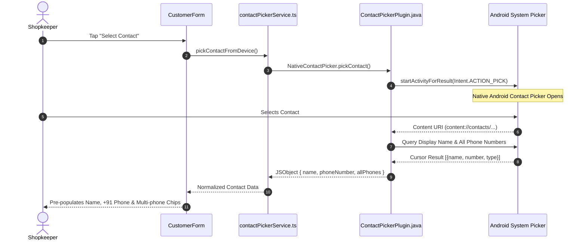
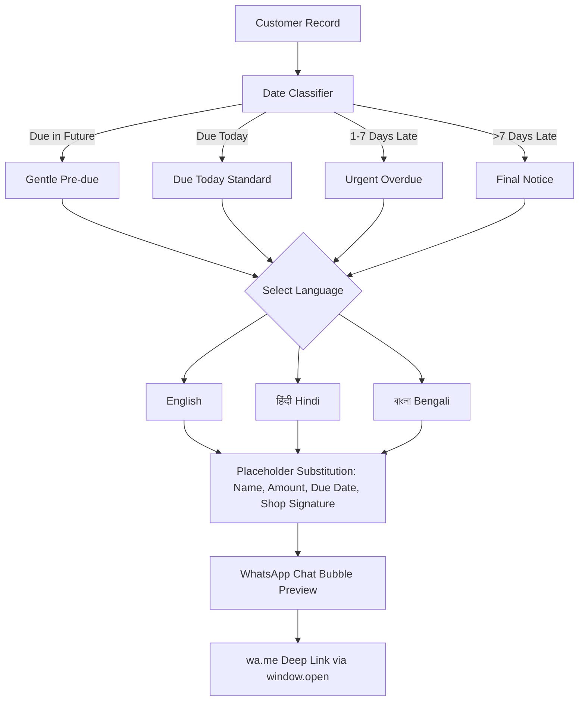
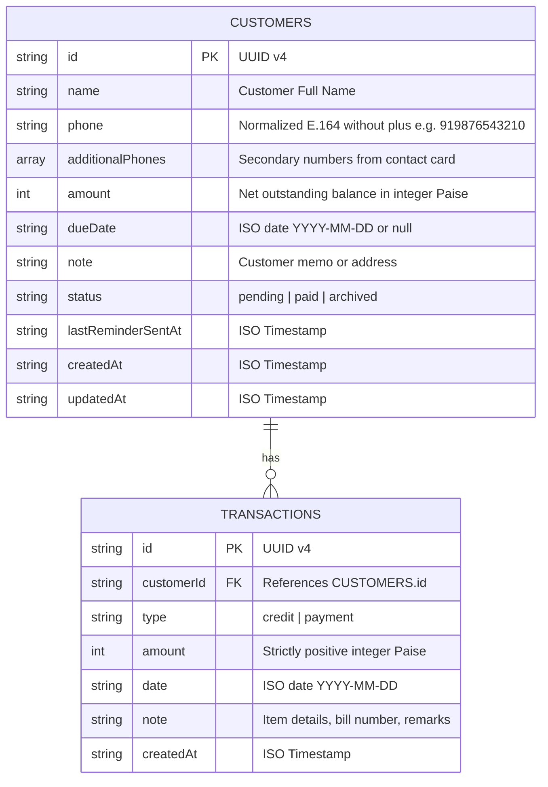

<p align="center">
  
</p>

<h1 align="center">बहीखाता — BahiKhata v2.1</h1>

<p align="center">
  <strong>Advanced Digital Financial Ledger, Multi-Installment Debt Settlement & Smart Payment Reminder System for Indian Merchants.</strong>
</p>

<p align="center">
  <a href="releases/v2.1.0/BahiKhata-v2.1.0.apk"></a>
  <a href="#️-system-architecture--clean-component-hierarchy"></a>
  <a href="#-automated-testing--quality-assurance"></a>
  <a href="LICENSE"></a>
</p>

<p align="center">
  
  
  
  
  
  
  
  
</p>

---

## 📖 Table of Contents

- [🌟 Product Vision & Design Philosophy](#-product-vision--design-philosophy)
- [📥 Download & Installation Guide](#-download--installation-guide)
- [🎨 Unified Design System & Visual Tokens](#-unified-design-system--visual-tokens)
- [📱 Screen-by-Screen Architecture](#-screen-by-screen-architecture)
- [🏗️ System Architecture & Clean Component Hierarchy](#️-system-architecture--clean-component-hierarchy)
- [🔄 Double-Entry Ledger State Machine](#-double-entry-ledger-state-machine)
- [📱 Native Android Contact Picker Integration](#-native-android-contact-picker-integration)
- [🔢 Mathematical Financial Precision (Zero Floating-Point)](#-mathematical-financial-precision-zero-floating-point)
- [💬 Multilingual WhatsApp Reminder Engine](#-multilingual-whatsapp-reminder-engine)
- [🗄️ Database Schema & Storage Architecture](#️-database-schema--storage-architecture)
- [🛠️ Technology Stack](#️-technology-stack)
- [💻 Developer Quickstart & Build Instructions](#-developer-quickstart--build-instructions)
- [🧪 Automated Testing & Quality Assurance](#-automated-testing--quality-assurance)
- [🔒 Privacy & Security Commitments](#-privacy--security-commitments)
- [📄 License & Credits](#-license--credits)

---

## 🌟 Product Vision & Design Philosophy

**BahiKhata (बहीखाता)** replaces the traditional red cloth-bound Indian merchant account book (*Lal Bahi*) with a modern, distraction-free digital ledger designed with surgical UI discipline.

### The Problem It Solves
Small shopkeepers, kirana owners, tailors, tutors, and freelance merchants lose thousands of rupees every month to forgotten debts, awkward reminder phone calls, and calculation errors. Cloud apps demand phone numbers, mandatory accounts, cloud sync subscriptions, and invasive contact access.

### The BahiKhata Solution
```
Add Customer (or Pick Contact) ➔ Record Credit/Payment ➔ Check Balance ➔ Send WhatsApp Reminder in 2 Taps
```

- **100% Offline & Private:** Runs entirely on-device inside IndexedDB (`bahikhata_db`). Zero servers, zero telemetry, zero accounts.
- **Native Android Ergonomics:** 5-destination thumb navigation, safe-area inset handling, responsive layouts from 320px to 412px+, and hardware back-button handling.
- **Integer-Paise Precision:** Zero floating-point rounding bugs ($₹100.50 \rightarrow 10050 \text{ paise}$).
- **Non-Invasive Contact Picker:** Only the single contact selected by the user is retrieved; address books are never uploaded or indexed.

---

## 📥 Download & Installation Guide

| Build Asset | Target Version | SHA-256 Checksum | Download Link |
| :--- | :--- | :--- | :--- |
| **BahiKhata v2.0.0 APK** | Android 7.0+ (Nougat through 15) | `38c26beeaf6fa446c6c8a09e0ccec8fff0cef9107d658d3f328bd2e03002ca7e` | [📦 Download BahiKhata-v2.0.0.apk](releases/v2.0.0/BahiKhata-v2.0.0.apk) |
| **Checksum Manifest** | Any | Text File | [📄 SHA256SUMS.txt](releases/v2.0.0/SHA256SUMS.txt) |

### Direct Phone Installation
1. Download **[BahiKhata-v2.0.0.apk](releases/v2.0.0/BahiKhata-v2.0.0.apk)** directly on your Android phone.
2. Tap the file in your notification panel or Downloads folder.
3. Select **Install** (if prompted, enable *Install unknown apps* for your browser/file manager).
4. Launch **BahiKhata** and manage your store ledger immediately.

### Command-Line Installation via ADB
```bash
# Check connected Android device
adb devices

# Install/Update APK
adb install -r releases/v2.0.0/BahiKhata-v2.0.0.apk

# Launch App
adb shell am start -n com.bahikhata.app/.MainActivity
```

---

## 🎨 Unified Design System & Visual Tokens

The visual system adheres to strict principles derived from **Apple Human Interface Guidelines**, **Wise**, **Linear**, and **Material Design 3**:



### Color Palette Tokens
| Token | Hex Value | Semantic Usage |
| :--- | :--- | :--- |
| `--color-bk-brand-primary` | `#B3262D` | Traditional Khata Burgundy/Crimson; primary buttons and active indicators |
| `--color-bk-brand-primary-hover`| `#981E24` | Interactive hover state |
| `--color-bk-canvas` | `#F8F7F4` | Warm parchment background canvas; easy on merchant eyes |
| `--color-bk-surface` | `#FFFFFF` | Crisp white card surface |
| `--color-bk-surface-soft` | `#F3F0EA` | Soft muted parchment for inner chips, avatars, and tags |
| `--color-bk-border` | `#E8E6E1` | Subtle hairline dividers and card boundaries |
| `--color-bk-text-primary` | `#252525` | High-contrast charcoal text |
| `--color-bk-text-secondary` | `#737373` | Balanced secondary helper text |
| `--color-bk-text-tertiary` | `#949494` | Timestamps and subtle metadata |
| `--color-bk-status-overdue` | `#B3262D` | Pending debts and credit given (+ Udhaar) |
| `--color-bk-status-paid` | `#166534` | Fully settled accounts and payments received (- Jama) |
| `--color-bk-status-pending` | `#D97706` | Approaching due dates and warnings |

### Spacing & Typography Scale
- **Grid Unit:** Strict 4px scale, favoring 8px increments for layouts (`px-3.5`, `px-4`, `gap-2.5`, `space-y-3.5`).
- **Touch Targets:** Standardized $\ge 44\text{px}$ touch target heights (`h-10` / `h-11` for buttons and inputs; `h-8` for compact card action chips).
- **Typography:** `Inter` variable font with strict optical weights (`font-extrabold` for names/headings, `font-mono font-bold` for currencies, `font-medium` for subtitles).

---

## 📱 Screen-by-Screen Architecture

### 1. Customer Dashboard (`CustomerList.tsx`)
- **Header:** Balanced identity, shop name, bulk spreadsheet paste button, settings trigger, and compact Add Customer action.
- **Wise-Inspired Hero Card:** Highlights total pending dues as the primary figure, with pending account count, overdue account count, and compact today's cashflow badge.
- **Search & Sort Toolbar:** Real-time search across customer names, phones, and notes; compact sorting (Recent, Balance, Name, Due Date).
- **Filter Chips:** Horizontally scrollable status chips: All, Pending, Due Today, Overdue, Settled.
- **Unified Customer Cards:** Reusable `CustomerCard` component featuring initials avatar, formatted phone, due status, relative due indicator, note preview, and responsive action bar (Edit, Delete, `+ Credit`, `- Payment`, and `Remind`).

### 2. Transaction Activity Feed (`TransactionsFeed.tsx`)
- **Cashflow Summary Banner:** Compact dual summary displaying Gave (+ Credit) vs Got (- Payment) totals.
- **Feed Search & Filters:** Filter by All Entries, Credit Only, or Payment Only.
- **Chronological List:** Color-coded transaction cards showing customer name, transaction date, custom note, and amount with sign indicator.

### 3. Record Transaction Modal (`QuickTransactionModal.tsx`)
- **Balanced Bottom Sheet:** Smooth slide-up sheet respecting Android keyboard and screen bounds.
- **Type Toggle:** Instant toggle between Gave Credit (+ Udhaar) and Got Payment (- Jama).
- **Searchable Customer Selector (`CustomerSelector.tsx`):** Custom high-fidelity dropdown replacing raw system selects, with real-time search, customer avatar, phone, and current balance preview.
- **Amount & Presets:** Large ₹ input with integer-paise conversion, date selector, and optional item note.

### 4. Payment Follow-Up Queue (`RemindersQueue.tsx`)
- **Prioritized Urgency Sorting:** Automatically ranks overdue accounts first, followed by due today, sorted by debt magnitude.
- **Direct 1-Tap Reminders:** Opens the pre-filled WhatsApp message composer for the selected customer in one tap.

### 5. Settings & Preferences (`SettingsModal.tsx`)
- **Tabbed Interface:** Business & Reminders, Appearance, Data & Backup, About & Privacy.
- **Authentic WhatsApp Preview:** Live chat bubble mockup displaying real WhatsApp bubble colors (`#d9fdd3`), timestamps, and double-blue ticks.
- **Data Protection:** CSV export, complete JSON backup, CSV import, and protected 2-step deletion requiring typing "DELETE".

---

## 🏛️ Advanced Financial Ledger Engine Architecture

BahiKhata v2.1 introduces a production-grade, mathematically consistent financial accounting engine (`src/domain/ledgerEngine.ts`) built from first principles for Indian trade.

### 1. Dual Independent Financial Positions
Unlike rudimentary calculators that collapse all interactions into a single opaque number, BahiKhata treats **Accounts Receivable** and **Accounts Payable** as distinct, independent balance sheets per contact:
- **Accounts Receivable (Money Owed TO ME):** Generated by credit sales (`credit_given`). Decreased by customer payments (`payment_received`).
- **Accounts Payable (Money I OWE TO OTHERS):** Generated by credit purchases or debts taken (`debt_incurred`). Decreased by payments made (`payment_made`).
- **Simultaneous Positions:** If Rahul owes ₹5,000 for retail goods, and you owe Rahul ₹2,000 for dairy supplies, both are visible simultaneously without premature cancellation (`Net: ₹3,000 Owes You`).

### 2. Bilateral Mutual Settlement
When a contact holds both receivable and payable balances, the merchant can trigger an explicit, confirmed **Mutual Settlement** (`mutual_adjustment`):
$$\text{Max Offset} = \min(\text{Receivable}, \text{Payable})$$
The mutual adjustment offsets equal portions of open debts via FIFO without requiring physical currency exchange, generating an audited transaction record.

### 3. Unified Transaction Types Matrix

| Transaction Type | Direction | Default Effect | Overflow / Excess Handling |
|---|---|---|---|
| `credit_given` | Receivable | Increases Outstanding Receivable | Consumes existing Customer Advance first |
| `payment_received`| Receivable | Decreases Outstanding Receivable | Excess payment converts to **Customer Advance** |
| `advance_received`| Receivable | Increases Customer Advance Balance | Stored for future bill adjustment |
| `refund_given` | Receivable | Decreases Customer Advance | Validated against available advance |
| `debt_incurred` | Payable | Increases Outstanding Payable | Consumes existing Supplier Advance first |
| `payment_made` | Payable | Decreases Outstanding Payable | Excess payment converts to **Supplier Advance** |
| `advance_paid` | Payable | Increases Supplier Advance Balance | Stored for future debt adjustment |
| `refund_received`| Payable | Decreases Supplier Advance | Validated against available advance |
| `mutual_adjustment`| Bilateral | Reduces both Receivable & Payable | FIFO settlement across active debts |
| `reversal` | Neutral | Corrects earlier entry | Preserves permanent immutable audit trail |

### 4. Flexible Multi-Installment Debt Settlement
Debts do not follow rigid monthly EMIs; merchants receive payments whenever customers have cash. BahiKhata supports:
- **Irregular Installment Amounts & Dates:** Track partial payments across days or weeks.
- **Per-Bill Progress Tracking:** Each credit bill tracks `originalAmountPaise`, `settledAmountPaise`, and `remainingAmountPaise` with visual progress bars.
- **Smart Debt Allocation:** Choose automatic FIFO (oldest debt settled first) or target a specific invoice/bill for settlement.
- **Overpayment Safety:** If a customer owes ₹3,000 and pays ₹4,000, the bill is fully settled (₹0 due) and ₹1,000 is safely credited to their advance balance.

---

## 🏗️ System Architecture & Clean Component Hierarchy



---

## 🔄 Double-Entry Ledger State Machine



---

## 📱 Native Android Contact Picker Integration



---

## 🔢 Mathematical Financial Precision (Zero Floating-Point)

In standard JavaScript, binary IEEE-754 floating-point arithmetic causes rounding errors:
```javascript
// Floating-point inaccuracy in standard JS:
0.1 + 0.2 = 0.30000000000000004
```

To eliminate any discrepancy in merchant balances, BahiKhata stores every monetary amount as an **integer number of Paise**:

$$\text{Paise} = \text{round}(\text{Rupees} \times 100)$$

$$\text{Net Balance} = \sum_{k=1}^{n} \text{Credit}_k - \sum_{j=1}^{m} \text{Payment}_j$$

$$\text{Display Rupees} = \frac{|\text{Net Balance}|}{100}$$

| Condition | Mathematical Meaning | UI Badge | Display Color |
| :--- | :--- | :--- | :--- |
| $\text{Balance} > 0$ | Customer owes store | `Due` | 🔴 Crimson (`text-bk-status-overdue`) |
| $\text{Balance} = 0$ | Fully settled account | `Settled` | 🟢 Forest Green (`text-bk-status-paid`) |
| $\text{Balance} < 0$ | Customer paid advance | `Advance` | 🔵 Blue (`text-blue-600`) |

---

## 💬 Multilingual WhatsApp Reminder Engine



### Pre-configured Message Samples
- **English:**
  > *"Hello Ramesh Patel, this is a gentle reminder that your pending balance of ₹1,500.00 is due on 15 Nov. Thank you! — Sharma General Store"*
- **हिंदी (Hindi):**
  > *"नमस्ते Ramesh Patel, यह एक विनम्र अनुस्मारक है कि आपकी ₹1,500.00 की लंबित राशि 15 Nov को देय है। धन्यवाद! — Sharma General Store"*
- **বাংলা (Bengali):**
  > *"নমস্কার Ramesh Patel, এটি একটি মৃদু অনুস্মারক যে আপনার ₹1,500.00 টাকার বকেয়া বিলটি 15 Nov তারিখে পরিশোধ করার কথা। ধন্যবাদ! — Sharma General Store"*

---

## 🗄️ Database Schema & Storage Architecture



---

## 🛠️ Technology Stack

| Layer | Technology | Key Capabilities |
| :--- | :--- | :--- |
| **Presentation Framework** | React 19.2 + TypeScript 6 | Virtual DOM, Hooks, strict type-checking |
| **Styling & System Tokens**| TailwindCSS v4 + CSS Variables | Dynamic density, text-scaling, brand tokens |
| **Native Runtime** | Capacitor v8.1 (Android) | High-speed WebView bridge, Intent handlers |
| **Android Native Layer** | Java 17 + Android SDK 36 | `Intent.ACTION_PICK` Contact Picker Plugin |
| **Local Storage Engine** | IndexedDB v2 (`bahikhata_db`) | Fast on-device client database with cascade delete |
| **Test Runner** | Vitest 4.1 | 37/37 passing unit tests |
| **Linter & Formatter** | Oxlint 1.79 | Zero error static code inspection |
| **Build & Compilation** | Vite 8 + Gradle 8.14 | Sub-second bundle times, native APK packaging |

---

## 💻 Developer Quickstart & Build Instructions

### Prerequisites
- **Node.js:** v20+ with npm
- **Java:** JDK 17 (Eclipse Temurin / OpenJDK)
- **Android SDK:** Platforms 34–36 with build-tools
- **ADB:** Android platform-tools

### 1. Clone & Setup
```bash
git clone https://github.com/joydeepdas-01/BahiKhata.git
cd BahiKhata
npm install
```

### 2. Run Local Development Server
```bash
npm run dev
```

### 3. Run Verification Suite
```bash
npm run lint
npm test
```

### 4. Build Production Web Assets & Sync to Android
```bash
npm run build
npx cap sync android
```

### 5. Compile Android Debug APK
```bash
cd android
./gradlew.bat assembleDebug
```
The compiled binary will be located at:
`android/app/build/outputs/apk/debug/app-debug.apk`

### 6. Install to Connected Android Device
```bash
adb install -r android/app/build/outputs/apk/debug/app-debug.apk
adb shell am start -n com.bahikhata.app/.MainActivity
```

---

## 🧪 Automated Testing & Quality Assurance

All 55 tests pass with 100% reliability across all 8 domain and ledger suites:

```text
 ✓ src/domain/__tests__/ledgerEngine.test.ts (18 tests)
 ✓ src/domain/__tests__/customer.test.ts (4 tests)
 ✓ src/domain/__tests__/amountFormatter.test.ts (7 tests)
 ✓ src/domain/__tests__/phoneNormalizer.test.ts (8 tests)
 ✓ src/domain/__tests__/dateClassifier.test.ts (9 tests)
 ✓ src/domain/__tests__/templates.test.ts (3 tests)
 ✓ src/domain/__tests__/csvHelper.test.ts (3 tests)
 ✓ src/domain/__tests__/tsvHelper.test.ts (3 tests)

 Test Files  8 passed (8)
      Tests  55 passed (55)
   Duration  390ms
```

---

## 🔒 Privacy & Security Commitments

1. **Zero External Communication:** The app makes zero network calls to external APIs or analytics servers.
2. **Contact Sandboxing:** Contact names and numbers picked through Android's contact picker never leave device storage.
3. **No Cloud Leakage:** Backups are generated locally as standard `.csv` or `.json` files saved directly to your phone.
4. **Controlled Messaging:** All reminder messages require user review and explicit send confirmation inside the official WhatsApp app.

---

## 📄 License & Credits

Distributed under the **MIT License**. See [LICENSE](LICENSE) for full details.

Crafted with ❤️ for India's hardworking merchants and small shopkeepers.
