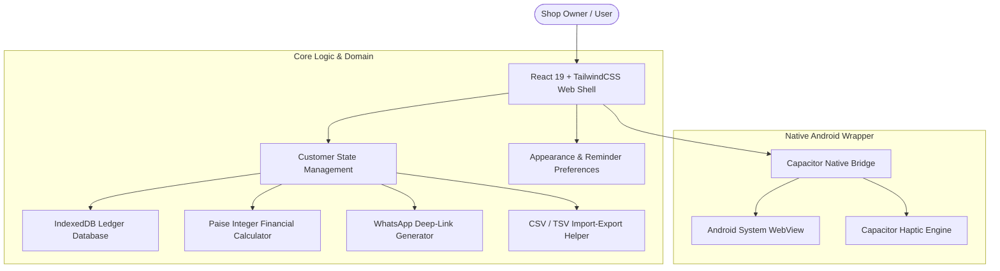

# BahiKhata System Architecture

This document describes the software architecture, data flow, and component organization of BahiKhata.

---

## 1. High-Level Architecture

BahiKhata is designed as an **offline-first, zero-cloud mobile ledger application** built using modern web web technologies wrapped inside Capacitor for Android.

---

## 2. Key Architectural Guarantees

1. **100% Offline Data Autonomy**:
   All customer records, transaction amounts, due dates, notes, and preferences are stored exclusively inside IndexedDB (`bahikhata_db`). Data never leaves the device.

2. **Financial Integer Precision**:
   Amounts are converted from user input (e.g. `₹150.50`) directly into **Integer Paise** (`15050` Paise) before writing to state or database. All summation, balances, and overdue tallies operate strictly on integer arithmetic, eliminating floating-point rounding errors.

3. **Independent Typography Scaling**:
   Text size adjustments (**Small**, **Standard**, **Large**, **Extra Large**) operate purely on CSS variables (`--app-font-scale`, `--app-body-font-size`, `--app-heading-scale`, `--app-label-scale`). HTML root font size is locked at `16px`, ensuring font scaling never shrinks container width or distorts UI geometry.

4. **Outer Content Margin System**:
   A centralized container utility (`AppContentContainer`) applies safe 8px–12px outer horizontal margins (`--content-margin-inline: 10px`) across all mobile screens, ensuring cards, search bars, filter chips, and dialogs sit comfortably inside the viewport.
